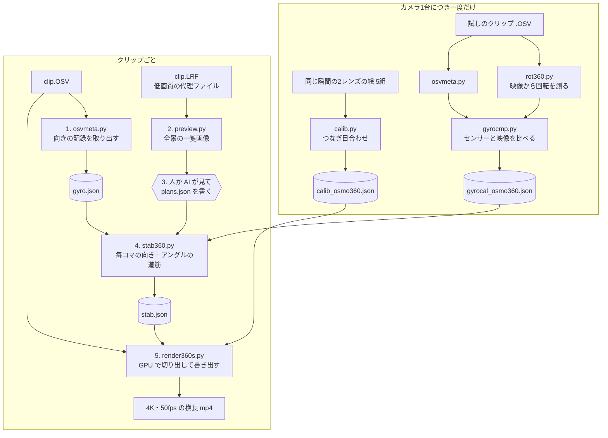
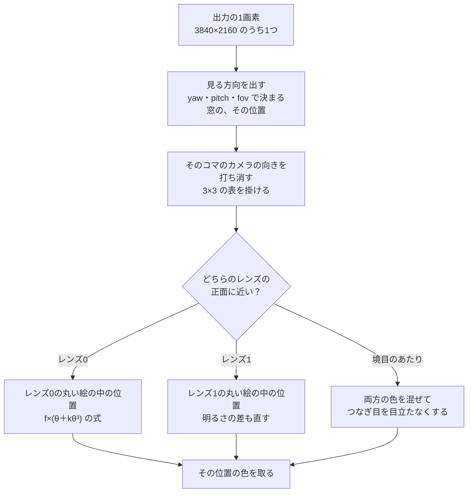

# Osmo 360 の動画を、ふつうの横長動画にする仕組み

DJI Osmo 360 の .OSV（このカメラの元の動画ファイル。前後2つのレンズの映像・音・センサーの記録が1つに入っている）から、決めた方向だけを切り出し、揺れを止めて、ふつうの横長動画にする自作プログラム集の説明。DJI とは関係のない個人の道具。

## 3行でいうと

1. 背中合わせの2つの魚眼レンズ（180度より広い範囲を1枚の丸い絵に収めるレンズ。端ほど景色が曲がって写る）の映像から、見たい方向だけを四角く切り出して、4K（横3840×縦2160画素）・50fps（1秒に50枚）の動画にする。
2. 揺れ止めには、カメラ自身が .OSV に書き込んでいる「その瞬間カメラがどちらを向いていたか」の記録を使う。毎コマその向きを打ち消してから切り出す。ここは計算だけで、AI は使わない。
3. 「いつ・どの方向を映すか」だけは誰かが決めて `plans.json`（アングルの予定表）に書く。これまでは AI（Claude）が全景の一覧画像を見て書いた。人が手で書いてもいい。

## 3つの質問への答え

### 動画を通すだけで楽になる？

揺れ止め・2つのレンズのつなぎ合わせ・書き出しは、コマンドを打てばあとはプログラムが全部やる。1コマずつ手で直す作業はない。

ただ、今は「ファイルを入れたら完成品が出てくる」ボタン1つにはなっていない。クリップ1本ごとに、次のコマンドを順に打つ。

| 順 | やること | 自動か |
|---|---|---|
| 1 | `osvmeta.py`：.OSV からカメラの向きの記録を取り出す | 自動 |
| 2 | `preview.py`：全景の一覧画像を作る | 自動 |
| 3 | 一覧画像を見て、`plans.json` にアングルを書く | **人か AI の判断が要る** |
| 4 | `stab360.py`：毎コマの向きと、アングルの道筋を作る | 自動 |
| 5 | `render360s.py`：4K・50fps で書き出す（20秒の動画で約70秒） | 自動 |

このほかに、カメラ1台につき一度だけの準備が2つある（つなぎ目合わせと、センサーの軸合わせ）。作った時に使ったカメラの結果（`calib_osmo360.json`、`gyrocal_osmo360.json`）はもうあるので、同じカメラなら毎回はやらない。

アングルを1つに決めてしまうなら、2と3は飛ばせる。残るのは 1・4・5 の3つのコマンドだけ。これを1回で流すまとめ役のスクリプトは、まだない。

### AI は必要？

揺れ止めと書き出しに AI は要らない。アングル選びには、今は AI か人が要る。

- スクリプトの中に、AI を呼び出す所は1つもない（全部の .py を確認した）。やっているのは、ファイルの読み出し、回転の計算、画像の座標の計算だけ。
- PyTorch（本来は AI を作るための部品集）を使っているが、ここでは「GPU でたくさんの計算を一度にやる電卓」として使っている。GPU は画像を描くための計算部品で、単純な計算を何千も同時にこなせる。学習済みの AI モデルは1つも入っていない。
- 一度だけ使う `calib.py` は、「数字を少しずつ直して、ずれを小さくしていく」という、AI の学習と同じやり方を使う。ただ、決めるのはレンズの数字12個だけで、AI を作っているわけではない。
- AI が担当していたのは手順3だけ。Claude が一覧画像を見て「この時刻は右後ろに見どころがある」と判断し、`plans.json` を書いた。この判断はプログラムには入っていない。

人が代わりにやるなら、こうする。

1. `preview.py` が作った一覧画像を開く。1枚に、指定した秒ごとの全景が 2列×5段で並ぶ。黄色の縦線が左右の向き（45度ごと、数字つき）、水色の横線が上下の −30度・0度・+30度。
2. 映したい物が写っている時刻と、その位置の黄色い線の数字を読む。
3. `plans.json` に1行ずつ書く（書き方は下の「手順3」）。

最低限は、アングル1つ。たとえば次の数行で「持っている人の前方を、カメラの向きにゆっくりついていきながら映す」になる。

```json
{
  "0001": [
    {"t": 0, "lock": "cam", "yaw": 180, "pitch": 0, "fov": 100}
  ]
}
```

`"0001"` はクリップの名前で、コマンドにも同じ名前を書く。`yaw` は左右の向き、`pitch` は上下の向き、`fov` は画角（窓の広さ）で、どれも単位は度。`"lock": "cam"` は「カメラの向きについていく」という指定（くわしくは手順3）。このコードでは yaw 0 がレンズ0の正面で、コードの注記ではレンズ0は持つ人の側を向く（自撮りのアングルが yaw 0 付近になっているのはそのため）。だから yaw 180 が持つ人の前方になる。持ち方が違う時は、一覧画像で確かめてから書く。

### どう動いているか

ひとことで言うと、こういう仕組み。

大きなガラス玉の内側に、2つのレンズの丸い絵を貼り合わせて、360度の景色を作る。玉の真ん中に立って、四角い窓枠を決めた方向にかざす。窓から見えた部分が、出力の1枚になる。カメラが揺れるとガラス玉も一緒に回ってしまうが、どれだけ回ったかはカメラのセンサーの記録で分かる。だから窓のほうをその分だけ回し返す。これを1秒に50回くり返す。

順番は下の図のとおり。

## 全体の流れ



## 各ステップ

### 準備A（カメラ1台につき一度）：2つのレンズのつなぎ目を合わせる — `calib.py`

- 入れる物：同じ瞬間の、レンズ0とレンズ1の絵の組を5組（`f0_0.png`〜`f4_1.png`）。この切り出しはスクリプトに入っていないので、ffmpeg などで別に作る。
- 出る物：`calib.json`（作った時のカメラ用は `calib_osmo360.json`）。レンズの中心の位置、焦点（どれだけ広く写るか）、ゆがみ、2つのレンズの向きの小さなずれ、明るさの差、の12個の数字。

魚眼レンズの絵では、レンズの正面から θ 度ずれた方向が、丸い絵の中心から「f ×（θ ＋ kθ³）」の距離に写る、と考える。f と k はレンズごとの数字で、k はゆがみの補正。2つのレンズは背中合わせなので、ちょうど真横（レンズの軸から83〜97度）の帯は両方に写っている。そこで約2万の方向を選び（持ち手や手が写る下のほうは除く）、両方のレンズの色の差を測る。差が小さくなるように12個の数字を少しずつ直す。これを600回くり返す。

たとえるなら、薄い紙に描いた2枚の絵を重ねて窓に透かし、線がぴったり重なるまで少しずつずらす作業。

### 準備B（カメラ1台につき一度）：センサーの軸と時計を合わせる — `rot360.py` → `gyrocmp.py`

- 入れる物：試しのクリップ1本の、向きの記録（手順1の `gyro.json`）と、映像から測った回転（`rot360.py` の結果）。
- 出る物：`gyrocal.json`（作った時のカメラ用は `gyrocal_osmo360.json`）。

センサーにとっての「前・右・下」と、映像にとっての「前・右・下」は、同じとは限らない。記録の時刻もわずかにずれる。そこでまず `rot360.py` が、映像だけから毎コマの回転を測る。絵の中の目立つ点（角や模様）を数百個選び、次のコマでどこへ動いたかを追う。歩く人のように景色と違う動きをする点は外す。この作業には OpenCV（画像処理の定番の部品集）を使う。

次に `gyrocmp.py` が、センサーの時刻を −60〜+60 ミリ秒の範囲でずらしながら、両者が一番よく合う「軸の対応」と「時刻のずれ」を探す。

作った時のカメラでは、合わせたあとの差は1コマあたり中央値（並べた時の真ん中の値）で 0.07〜0.08度だった。時刻のずれはクリップ 0048 で 2.4ミリ秒、0050 で 1.0ミリ秒。軸の対応は2本で 0.7度しか違わなかったので、同じカメラなら一度で足りる。

たとえるなら、新しい腕時計とコンパスを、駅の時計と北に合わせておくこと。一度合わせれば、同じ道具ならそのまま使える。

### 手順1：向きの記録を取り出す — `osvmeta.py`

- 入れる物：`clip.OSV`
- 出る物：`gyro.json`。毎コマの撮影時刻と、そのコマの間のカメラの向き（1コマに33〜34個）。

カメラの中には、傾きを1秒に1000回はかるセンサー（ジャイロ）がある。スマホのゲームで本体を傾けて操作できるのも、同じ種類の部品のおかげ。Osmo 360 は、ジャイロなどの値から計算した「カメラがどちらを向いていたか」を、.OSV の中に毎コマ書き込んでいる。

.OSV の中身は MP4 と同じで、「箱の中に箱が入っている」形をしている。映像2本と音のほかに、DJI が `djmd` と名前をつけた記録の列があり、毎コマの情報が protobuf（Google が作った、データを小さく詰めて保存する書き方）で入っている。`osvmeta.py` は箱を順に開けてこの列を探し、中の「向き」を取り出す。

向きはクォータニオンで書かれている。クォータニオンは、向きを4つの数で表す書き方。「左右に何度・上下に何度・傾き何度」の3つの角度で表すと、真上を向いた時などに計算が崩れることがあるので、センサーや3Dの計算ではこちらがよく使われる。

Python に最初から入っている機能だけで動く。GPU も DJI のソフトも要らない。

たとえるなら、段ボールを開けると小箱があり、その中に日記帳がある。日記帳には「この瞬間、カメラはこっちを向いていた」が1秒に約1000行書いてある。

### 手順2：全景の一覧画像を作る — `preview.py`（と `sheet.py`）

- 入れる物：`clip.LRF`（カメラが一緒に保存する低画質の代理ファイル。2048×1024 で、2つの魚眼の絵が横に並んでいる）と `calib.json`。
- 出る物：jpg の一覧画像。1枚に 2列×5段。

指定した秒ごとに、2つの魚眼の絵をつなげて、正距円筒の 960×480 の絵にする。正距円筒は世界地図と同じ広げ方で、横が左右360度、縦が真上から真下までの180度。黄色の縦線は左右の向き（−180〜180度、45度ごと、数字つき）、水色の横線は上下の −30度・0度・+30度。左下に時刻が入る。

`sheet.py` は別の用途。複数のファイルについて、長さの10%・50%・90%の3か所の絵を1行に並べる（.OSV なら片方のレンズの絵だけ）。どのファイルに何が写っているかをざっと見る用で、360度の全景にはならない。

注意：一覧画像はカメラ基準のままで、水平に直していない。カメラを前後や左右に傾けて持っていた場面では、上下の目盛りが本当の水平とずれる。書き出しでは上下の角度を水平基準で使うので、その分だけずれる。

### 手順3：アングルを決めて `plans.json` に書く（人か AI）

クリップ名ごとに、アングルを時刻順に並べる。1行が1つのアングル。

| 項目 | 意味 |
|---|---|
| `t` | この秒から、このアングルになる |
| `lock` | `"world"`（景色に固定）か `"cam"`（カメラについていく） |
| `yaw` | 左右の向き（度）。0 がレンズ0の正面、＋が右回り |
| `pitch` | 上下の向き（度）。＋が上、0 が水平 |
| `fov` | 横の画角（度）。窓の広さで、小さいほど寄って写る。例のファイルでは 90〜110 |
| `ref` | `world` の時だけ使う。`yaw` を読んだ一覧画像の時刻。省くと `t` と同じ |
| `ease` | 前のアングルから何秒かけて移るか。移り終わるのが `t` の時刻。省くと 1.5秒 |
| `note` | メモ。プログラムは読まない |

`world` と `cam` の違い：

- `world`（景色に固定）：`ref` の瞬間のカメラの向きを基準に、その方向を景色に対して固定する。カメラを振り回しても、映す方向は動かない。首を回しても、壁の時計から目を離さないような映し方。
- `cam`（カメラについていく）：カメラの左右の向きについていく。ただし、約0.8秒の幅でならした向きを使う。手の細かい揺れにはついていかず、ゆっくりした向き変えにだけついていく。上下は水平が基準のまま。自撮りで自分を映し続ける時に使う。車のヘッドライトに近い。車が曲がれば光も曲がるが、路面のガタガタはここで吸収される。

「ならす」は、前後の値を、近いものほど重くして平均すること。細かいギザギザが消えて、ゆっくりした動きだけが残る。

アングルの切り替えは、`ease` 秒かけて「ゆっくり動き出して、ゆっくり止まる」動きでつなぐ。

例（3つのアングル）：

```json
{
  "0001": [
    {"t": 0,    "lock": "world", "ref": 0.5,  "yaw": 60,  "pitch": 20,  "fov": 100, "note": "見どころ1"},
    {"t": 5.5,  "ease": 1.5, "lock": "cam",   "yaw": -10, "pitch": -27, "fov": 105, "note": "自撮り"},
    {"t": 12.5, "ease": 1.5, "lock": "world", "ref": 12.5, "yaw": 110, "pitch": 15, "fov": 100, "note": "見どころ2"}
  ]
}
```

決めたアングルの確認には `preview_path.py` がある。小さな試し画像（480×270）を一定の間隔で並べ、顔が切れていないか、傾いていないかを見る。ただしこれは前の版の計算（映像から推定した左右の首振りだけ）で道筋を作るので、`motion.py` の結果が要る。揺れ止め版の書き出しとは少し違うことがある。

### 手順4：毎コマの向きとアングルの道筋を作る — `stab360.py`

- 入れる物：`gyro.json`、`gyrocal_osmo360.json`、`plans.json`、クリップ名。
- 出る物：`stab.json`。元のコマ（1秒に29.97枚）ごとの、カメラの向き（3×3 の数の表＝回転行列。向きを掛け算で扱える形）と、映す向き（yaw・pitch・fov）。

やっていること：

1. センサーの向きを、準備Bの対応表で「カメラの軸」に直す。時刻のずれもここで足す。
2. 「下」を重力の方向に決める（センサーは重力の向きを知っている）。だから地平線はいつもまっすぐになる。
3. 毎コマ、カメラ（レンズ0）が左右どちらを向いていたかを出す。
4. `plans.json` の各行を、この向きを使って「景色に対する向き」に直す。行と行のあいだは `ease` の間なめらかにつなぐ。最後に、前後2コマほどの幅で軽くならす。

### 手順5：4K・50fps で書き出す — `render360s.py`

- 入れる物：`clip.OSV`、`calib_osmo360.json`、`stab.json`。最後に `blend` と書くと、コマの間を混ぜる（ふだんは付ける）。
- 出る物：mp4。

ffmpeg（動画を開く・変換する・保存するための定番の無料ソフト）が、GPU の動画専用の回路を使って、2本の魚眼映像（それぞれ 3840×3840）をほどき、生の絵を Python に渡す。

出力の1枚は 3840×2160＝約830万画素。これを GPU で全部同時に計算する。1つの画素について、やることは次のとおり。



境目のあたり（設定値は8度）は、両方のレンズの色を少しずつ割合を変えて混ぜる。色を取る時、明るさは周りの16画素から、色は周りの4画素から、なめらかに計算する。色の情報は明るさの半分の細かさで持っている（ふつうの動画と同じ形式）。

#### 29.97枚から50枚へ（`blend`）

元の映像は1秒に29.97枚、出力は50枚。出力の1枚は、元の映像の「コマとコマの間」に当たることが多い。

| 出力の何枚目 | 0 | 1 | 2 | 3 | 4 | 5 |
|---|---|---|---|---|---|---|
| 元の映像のどこ | 0.0 | 0.6 | 1.2 | 1.8 | 2.4 | 3.0 |
| 前の版（近い1枚） | 0 | 1 | 1 | 2 | 2 | 3 |
| `blend`（前後2枚を混ぜる） | 0 | 0と1を 4:6 | 1と2を 8:2 | 1と2を 2:8 | 2と3を 6:4 | 3 |

前の版は近い1枚をそのまま出していたので、5枚に2枚が前と同じ絵になり、「動く・動く・止まる」のガクガクになった。`blend` を付けると、前後2枚を、それぞれ自分の向きを打ち消してから、時刻の割合で混ぜる。向きを消したあとなので、2枚の違いは歩いて進んだ分（数ピクセル）だけで、混ぜてもほとんどぼけない。

#### 保存

GPU の動画書き出し専用の回路（NVENC）で、HEVC（動画を小さく保存する方式の1つ。H.265 とも呼ぶ）の10bit（色の段階が細かい形式）で保存する。平均 50Mbps、最大 70Mbps。音は .OSV の音を AAC（ふつうの動画で使われる音の圧縮方式）192kbps・48kHz・ステレオにする。

形式は Osmo Action の動画とそのままつなげられるようにそろえてある：HEVC Main 10・hvc1・3840×2160・50fps・bt709（4K/HD 動画の標準の色の決まり）・タイムスケール 50000（ファイルの中で時刻を数える細かさ）。

## 測った結果

`jitter2.py` で、アングルが動かない区間について、画面全体の動きの中央値から測った。数字は4K画面のピクセル。「揺れ」は0.4秒より速い細かい動きの大きさ、「むら」はコマごとの動きのばらつき（「動く・動く・止まる」だと大きくなる）。

| 区間 | 前の版 | 揺れを止める版 |
|---|---|---|
| 0048 13.5〜19.5秒 | 揺れ 左右29・上下25、むら 9.5 | 揺れ 左右9.5・上下2.3、むら 0.7 |
| 0048 29.5〜35.5秒 | 揺れ 左右17・上下18、むら 5.2 | 揺れ 左右4.7・上下2.2、むら 0.4 |
| 0048 63〜70秒 | 揺れ 左右23・上下37、むら 7.0 | 揺れ 左右4.7・上下4.6、むら 0.6 |
| 0050 5.2〜10.8秒 | 揺れ 左右28・上下38、むら 9.3 | 揺れ 左右4.9・上下2.5、むら 0.5 |
| 0050 24.6〜29.8秒 | 揺れ 左右22・上下32、むら 8.9 | 揺れ 左右5.0・上下2.1、むら 0.9 |
| 0050 35〜40.5秒 | 揺れ 左右34・上下40、むら 8.2 | 揺れ 左右6.4・上下3.4、むら 0.5 |
| （参考）Osmo Action 0751 | 揺れ 左右22〜27・上下9〜15、むら 0.7〜1.0 | |

表から計算すると、揺れは左右で前の版の約3分の1〜6分の1、上下で約8分の1〜15分の1。どちらもアクションカメラより小さい。むらはアクションカメラと同じくらいになった。

測る区間にアングルの切り替え（`ease` の間の大きな首振り）が入ると、揺れの数字が50以上に跳ねる。区間は `plans.json` を見て、切り替えの手前で切る。

## AI がやる所、プログラムがやる所

| 作業 | 担当 | 中身 |
|---|---|---|
| つなぎ目合わせ（準備A） | プログラム | 数字12個を少しずつ直す計算。学習済みの AI は使わない |
| センサーの軸合わせ（準備B） | プログラム | 点の追跡と回転の計算 |
| 向きの記録を取り出す（手順1） | プログラム | ファイルを読むだけ |
| 全景の一覧画像（手順2） | プログラム | 2つの絵をつなげて広げる |
| 見どころ選び・アングル決め（手順3） | **AI か人** | コードには入っていない。今までは Claude が一覧画像を見て書いた |
| 試し画像で確かめる | 画像作りはプログラム、見るのは AI か人 | `preview_path.py` |
| 揺れ止めと道筋（手順4） | プログラム | 回転の計算となめらかなつなぎ |
| 切り出し・つなぎ・書き出し（手順5） | プログラム | GPU での座標の計算と ffmpeg |

## できないこと

- 360度カメラの1方向あたりの細かさは、ふつうのカメラより粗い（1度あたり約20画素）。4K に引き伸ばすので少し甘くなる。
- カメラを素早く振り回した場面は、元の映像そのものがぶれている。向きは合っても、ぶれた絵はそのまま。
- 消せるのは回転だけ。カメラごと人が歩いて上下左右に動く分（位置の揺れ）は消せない。近くの人ほど少し揺れて見える。
- `blend` を付けると、近くを素早く横切る人に、うっすら二重の影が出ることがある。気になる時は `blend` を付けずに書き出す（そのかわり、むらが戻る）。
- 音はふつうのステレオなので、「声のする方を向く」は作れない。
- 見どころを自動で選ぶ機能はない。AI か人が決める。
- 撮影設定を決め打ちしている：1レンズ 3840×3840、1秒に29.97枚、代理ファイル 2048×1024。ほかの設定で撮ったファイルは、コードの数字を直さないと動かない。
- 一覧画像と確認画像には、代理ファイル .LRF が要る。
- NVIDIA の GPU がないと動かない。

## 動かすのに必要なもの

- Windows で作って動かした。`preview.py` と `preview_path.py` は Windows のフォント（Arial）の場所を直接書いている。
- NVIDIA の GPU。CUDA（NVIDIA の GPU で計算するための仕組み）を使う。ffmpeg の読み込み（`-hwaccel cuda`・`scale_cuda`）と書き出し（`hevc_nvenc` の10bit HEVC）も GPU の専用回路を使う。
- Python 3、PyTorch（CUDA 対応版）、NumPy（数の表を扱う部品）、Pillow（画像を読み書きする部品）、OpenCV（`opencv-python`）。
- ffmpeg と ffprobe（CUDA に対応したもの）。
- 速さの目安（作った時の PC）：揺れ止め版の書き出しは 20秒の動画で約70秒。前の版の `render360.py` は1秒あたり約12コマ。

## ファイルの一覧

| ファイル | 役目 | いつ使う |
|---|---|---|
| `osvmeta.py` | .OSV から向きの記録を取り出す | クリップごと |
| `preview.py` | 全景の一覧画像 | クリップごと |
| `stab360.py` | 毎コマの向きとアングルの道筋（`gyro` と `image` の2通り。ふだんは `gyro`） | クリップごと |
| `render360s.py` | 揺れ止め版の書き出し | クリップごと |
| `calib.py` | 2つのレンズのつなぎ目合わせ | カメラ1台につき一度 |
| `rot360.py` | 映像だけで毎コマの回転を測る | カメラ1台につき一度（`gyrocmp.py` の材料） |
| `gyrocmp.py` | センサーと映像を比べて軸と時刻を合わせる | カメラ1台につき一度 |
| `geom360.py` | レンズの式・方向の計算など、共通の計算部品 | ほかのスクリプトが読む |
| `path360.py` | 道筋の部品（ならし・なめらかなつなぎ）と、前の版の道筋 | ほかのスクリプトが読む |
| `preview_path.py` | 決めたアングルの試し画像（前の版の計算） | 確認したい時 |
| `sheet.py` | 複数ファイルの中身をざっと並べる | 最初に何が写っているか見る時 |
| `motion.py` | 映像から左右の首振りだけを推定（前の版） | 前の版、`preview_path.py` 用 |
| `upright2.py` | 柱など縦の線から水平を推定（前の版・映像だけの版） | 今はふだん使わない |
| `render360.py` | 前の版の書き出し（左右だけ補正、近い1枚を出す） | 今はふだん使わない |
| `jitter2.py` | 揺れとむらを測る | 比べたい時 |
| `eqcheck.py` | 水平の補正を確かめる画像 | 前の版の確認用 |

`osvmeta.py` は、OpenOSV（Apache-2.0）の説明書き（ファイルの中身の説明と protobuf の定義）を読んで書いた。OpenOSV のプログラム自体は使っていないし、実行もしていない。
